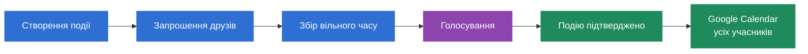

# PlanYourFriday

**Платформа для спільного планування подій у групі друзів.** Кожен позначає, коли він вільний, система знаходить найкращий час, група голосує, і подія сама з'являється в Google Calendar у всіх.

---

## Як це працює



1. **Створення події.** Організатор задає назву, вікно (коли подія може відбутися), тривалість і, за бажанням, дедлайн.
2. **Запрошення.** Посиланням або на email. Учасник заходить через свій Google-акаунт.
3. **Збір вільного часу.** Кожен позначає вільні проміжки на календарі: вручну, імпортом з Google Calendar або одним кліком за своїми «звичними годинами».
4. **Голосування.** Система пропонує до 6 найкращих варіантів, навіть якщо повного збігу немає (і показує, хто не може). Організатор вибирає варіанти й запускає голосування. Кожен відповідає **Підходить / Можливо / Не можу** (2 / 1 / 0 балів).
5. **Підтвердження.** Організатор фіксує час, додає місце, посилання й нотатки. Подія потрапляє в календарі учасників: організатор як власник, решта як гості.

## Можливості

| Розділ | Що там |
|---|---|
| **Головна** | Найближча подія, «твій хід» (де чекають на тебе), план на 7 днів |
| **Події** | Усі події з пошуком, вкладками за етапом (зокрема окремо минулі й скасовані), фільтром за роллю, сортуванням |
| **Сторінка події** | Календар вільного часу, найкращі варіанти, голосування, деталі події, скасування й видалення, учасники й запрошення |
| **Календар** | Усі плани з усіх подій: місяць, тиждень, список |
| **Ідеї** | Опитування серед друзів «що робимо?»: варіанти, голосування, переможець одразу стає подією. Нічия — крутимо колесо |
| **Друзі** | Додавання за посиланням, пошук за @ніком, підказки з людей, з якими вже щось планували. Друзів можна одразу додати в подію чи опитування |
| **Сповіщення** | Запрошення, старт голосування, дедлайни, підтвердження, зміни та скасування, заявки в друзі, опитування. Важливі ще й на email — за налаштуваннями |
| **Wheel** | Колесо ідей, якщо не знаєте, чим зайнятися. Результат одразу перетворюється на план |
| **Налаштування** | Профіль і @нік, підключення Google Calendar, звичний вільний час, email-сповіщення, тема, формат часу, експорт і видалення акаунта |

**Кольори означають етап**, однаково по всьому сайту:

| Колір | Етап |
|---|---|
| Синій | Збір вільного часу |
| Фіолетовий | Голосування |
| Зелений | Подію підтверджено |
| Сірий | Минуло або скасовано |
| Помаранчевий | Твій вільний час і те, що чекає на тебе |

## Архітектура

Модульний моноліт:

- **SPA** (`web/`): інтерфейс.
- **API App** (`src/PlanYourFriday.Api`): HTTP-запити, вхід через Google, бізнес-логіка подій, вільного часу й голосування.
- **Worker App** (`src/PlanYourFriday.Worker`): фонова робота — листи з outbox, синхронізація підтверджених подій у Google Calendar кожного учасника, нагадування про дедлайни й події, підсумки опитувань. Збій SMTP чи Google API не ламає запит користувача.
- **PostgreSQL**: дані, включно з таблицею outbox.

Шари бекенду: `Api` / `Worker` → `Application` (бізнес-правила й інтерфейси) → `Domain` (сутності), а `Infrastructure` реалізує інтерфейси (БД, Google, SMTP).

## Стек

| Частина | Технології |
|---|---|
| Frontend | React, TypeScript, Vite, React Router, TanStack Query, FullCalendar, Lucide |
| Backend | C#, ASP.NET Core Web API, .NET Worker Service (.NET 10) |
| База даних | PostgreSQL, Entity Framework Core |
| Інтеграції | Google OAuth 2.0, Google Calendar API, SMTP |

## Запуск

**Frontend** (потрібен Node.js 20.19+ або 22.12+):

```bash
cd web
npm install
npm run dev        # http://localhost:5173
npm run format     # Prettier; CI перевіряє через npm run format:check
npm run lint       # oxlint
```

За замовчуванням фронтенд працює з **мок-API** прямо в браузері, тож бекенд не потрібен. Щоб підключити справжній API, створіть `web/.env.development.local` з `VITE_USE_MOCKS=false` і запустіть бекенд: Vite проксіює `/api` на `http://localhost:5131`.

**Backend** (потрібні .NET 10 SDK і Docker):

```bash
cp .env.example .env                              # лише перший раз
docker compose up -d                              # PostgreSQL і Mailpit
dotnet run --project src/PlanYourFriday.Api       # http://localhost:5131, міграції застосовуються самі
dotnet run --project src/PlanYourFriday.Worker    # листи, Google Calendar, нагадування
```

Листи з локального запуску не йдуть назовні, а потрапляють у Mailpit: http://localhost:8025.

**Без ключів Google** у режимі розробки замість Google відкривається форма тестового входу: вводиш будь-який email і заходиш. Так зручно перевіряти кількома «друзями» в різних браузерах.

Для входу через Google створіть OAuth Client ID (тип Web application) у Google Cloud Console з двома redirect URI:

- `http://localhost:5173/api/auth/signin-google` (вхід);
- `http://localhost:5173/api/calendar-connections/google/callback` (підключення календаря).

Увімкніть **Google Calendar API** (APIs & Services → Library), а в OAuth consent screen → Data Access додайте scopes `.../auth/calendar.readonly` і `.../auth/calendar.events`. Ключі збережіть у user-secrets (не в git); API і Worker мають спільний `UserSecretsId`, тож достатньо одного разу:

```bash
dotnet user-secrets set "Authentication:Google:ClientId" "<client-id>" --project src/PlanYourFriday.Api
dotnet user-secrets set "Authentication:Google:ClientSecret" "<client-secret>" --project src/PlanYourFriday.Api
```

**Тести:** `dotnet test`. Інтеграційні тести (`tests/PlanYourFriday.IntegrationTests`) самі піднімають PostgreSQL у Docker, тож Docker має бути запущений. Вони звіряють кожну відповідь API з типами SPA у `web/src/api/types.ts`, тому якщо фронтенд і бекенд розійдуться, тест це покаже.

## Структура

```
PlanYourFriday/
├── web/                              SPA
├── src/
│   ├── PlanYourFriday.Api/           HTTP API
│   ├── PlanYourFriday.Worker/        фонова обробка outbox
│   ├── PlanYourFriday.Application/   бізнес-логіка, інтерфейси
│   ├── PlanYourFriday.Domain/        доменні сутності
│   └── PlanYourFriday.Infrastructure/ БД, Google, SMTP
└── tests/
    ├── PlanYourFriday.UnitTests/         домен і сервіси (NSubstitute)
    └── PlanYourFriday.IntegrationTests/  API + PostgreSQL у Docker, контракт із SPA
```

## Команда

| | Роль | Зона відповідальності |
|---|---|---|
| **Бублик Світлана** | Business Analyst, Frontend Engineer | C4 та UML-діаграми, SPA |
| **Забродін Максим** | Backend Engineer, DevOps Engineer | API, сервіси подій, запрошень і пошуку часу, схема БД, розгортання |
| **Хаймик Тетяна** | Backend Engineer, QA Engineer | Google OAuth і Calendar, Worker та outbox, SMTP, тести |
