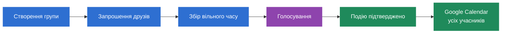

# PlanYourFriday

**Платформа для спільного планування подій у групі друзів.** Кожен позначає, коли він вільний, система знаходить найкращий час, група голосує, і подія сама з'являється в Google Calendar у всіх.

---

## Як це працює



1. **Створення групи.** Організатор задає назву, вікно (коли подія може відбутися), тривалість і, за бажанням, дедлайн.
2. **Запрошення.** Посиланням або на email. Учасник заходить через свій Google-акаунт.
3. **Збір вільного часу.** Кожен позначає вільні проміжки на календарі: вручну, імпортом з Google Calendar або одним кліком за своїми «звичними годинами».
4. **Голосування.** Система пропонує до 6 найкращих варіантів, навіть якщо повного збігу немає (і показує, хто не може). Організатор вибирає варіанти й запускає голосування. Кожен відповідає **Підходить / Можливо / Не можу** (2 / 1 / 0 балів).
5. **Підтвердження.** Організатор фіксує час, додає місце, посилання й нотатки. Подія потрапляє в календарі учасників: організатор як власник, решта як гості.

## Можливості

| Розділ | Що там |
|---|---|
| **Головна** | Найближча подія, «твій хід» (де чекають на тебе), план на 7 днів |
| **Групи** | Усі групи з пошуком, фільтрами за етапом і роллю, сортуванням |
| **Сторінка групи** | Календар вільного часу, найкращі варіанти, голосування, деталі події, учасники й запрошення |
| **Календар** | Усі плани з усіх груп: місяць, тиждень, список |
| **Сповіщення** | Запрошення, старт голосування, дедлайни, підтвердження, зміни та скасування |
| **Wheel** | Колесо ідей, якщо не знаєте, чим зайнятися. Результат одразу перетворюється на план |
| **Налаштування** | Профіль, підключення Google Calendar, звичний вільний час, email-сповіщення, тема, формат часу, експорт і видалення акаунта |

**Кольори означають етап**, однаково по всьому сайту:

| Колір | Етап |
|---|---|
| Синій | Збір вільного часу |
| Фіолетовий | Голосування |
| Зелений | Подію підтверджено |
| Сірий | Минуло або скасовано |
| Помаранчевий | Твій вільний час і те, що чекає на тебе |

## Архітектура

Модульний моноліт:

- **SPA** (`web/`): інтерфейс.
- **API App** (`src/PlanYourFriday.Api`): HTTP-запити, вхід через Google, бізнес-логіка груп, доступності й подій.
- **Worker App** (`src/PlanYourFriday.Worker`): фонова обробка outbox — листи й синхронізація з Google Calendar. Збій SMTP чи Google API не ламає запит користувача.
- **PostgreSQL**: дані, включно з таблицею outbox.

Шари бекенду: `Api` / `Worker` → `Application` (бізнес-правила й інтерфейси) → `Domain` (сутності), а `Infrastructure` реалізує інтерфейси (БД, Google, SMTP).

## Стек

| Частина | Технології |
|---|---|
| Frontend | React, TypeScript, Vite, React Router, TanStack Query, FullCalendar, Lucide |
| Backend | C#, ASP.NET Core Web API, .NET Worker Service (.NET 10) |
| База даних | PostgreSQL, Entity Framework Core |
| Інтеграції | Google OAuth 2.0, Google Calendar API, SMTP |

## Запуск

**Frontend** (потрібен Node.js 20.19+ або 22.12+):

```bash
cd web
npm install
npm run dev        # http://localhost:5173
```

За замовчуванням фронтенд працює з **мок-API** прямо в браузері, тож бекенд не потрібен. Щоб підключити справжній API, створіть `web/.env.development.local` з `VITE_USE_MOCKS=false` і запустіть бекенд: Vite проксіює `/api` на `http://localhost:5131`.

**Backend** (потрібен .NET 10 SDK):

```bash
dotnet run --project src/PlanYourFriday.Api
dotnet run --project src/PlanYourFriday.Worker
```

## Структура

```
PlanYourFriday/
├── web/                              SPA
├── src/
│   ├── PlanYourFriday.Api/           HTTP API
│   ├── PlanYourFriday.Worker/        фонова обробка outbox
│   ├── PlanYourFriday.Application/   бізнес-логіка, інтерфейси
│   ├── PlanYourFriday.Domain/        доменні сутності
│   └── PlanYourFriday.Infrastructure/ БД, Google, SMTP
└── tests/
    └── PlanYourFriday.UnitTests/
```

## Команда

| | Роль | Зона відповідальності |
|---|---|---|
| **Бублик Світлана** | Business Analyst, Frontend Engineer | C4 та UML-діаграми, SPA |
| **Забродін Максим** | Backend Engineer, DevOps Engineer | API, сервіси груп, запрошень і пошуку часу, схема БД, розгортання |
| **Хаймик Тетяна** | Backend Engineer, QA Engineer | Google OAuth і Calendar, Worker та outbox, SMTP, тести |
